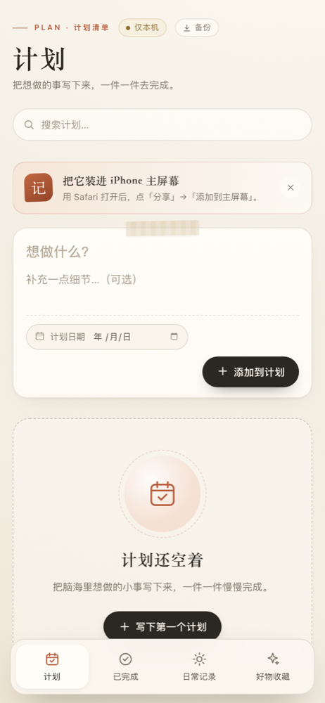

# 拾光 · iPhone 本地版（PWA）

数据只保存在这台 iPhone 的浏览器里：不上传云端、不需要服务器、不需要 Apple 开发者账号。



> 预览里是首次打开的样子，实际安装后不会有浏览器地址栏。

## 一、部署到 GitHub Pages

1. 登录 GitHub，新建一个 **Public** 仓库，例如 `shiguang`。
2. 在仓库首页点 **Add file → Upload files**。
3. 打开本文件夹 `iphone-pwa`，把**里面的所有文件和 `icons` 文件夹**拖进上传区域。
   - 注意：上传的是 `iphone-pwa` 里面的内容，不要在仓库里再多套一层 `iphone-pwa` 文件夹。
4. 点 **Commit changes**。
5. 进入仓库 **Settings → Pages**：
   - **Source** 选 `Deploy from a branch`
   - **Branch** 选 `main`，目录选 `/(root)`
   - 点 **Save**
6. 等 1～2 分钟，页面顶部会出现类似地址：

   ```
   https://你的用户名.github.io/shiguang/
   ```

7. 用 **iPhone Safari** 打开这个地址。

> 仓库必须是 public；页面里只有网页代码和图标，没有你的备忘录数据。
> `CNAME`、自定义域名都不需要。

## 二、装到 iPhone 主屏幕

**建议先安装，再从主屏幕图标里开始录入数据。**

1. iPhone Safari 打开上面的网址。
2. 点击 Safari 底部的「分享」按钮。
3. 选择「添加到主屏幕」→ 名称可以保留「拾光」→ 添加。
4. 回到桌面，从「拾光」图标打开。
5. 首次进入时可以关闭「把它装进 iPhone 主屏幕」的提示。

安装后可以离线打开；之后如果 GitHub Pages 更新了版本，联网打开一次即可获取新版。

## 三、把旧备忘录导入

1. 在原来的备忘录里点「备份」，导出一份 JSON 文件。
2. 保存到「文件」或 iCloud Drive。
3. 在 iPhone 主屏幕打开「拾光」→ 点标题旁的「备份」按钮 →「从备份恢复」。
4. 选择刚才的 JSON 文件。

以后建议每周点一次「备份 → 备份到文件」，保存到「文件」或 iCloud Drive。

## 四、重要说明

- **数据只在这台 iPhone 上**，不会与 Mac、Windows 或其他手机同步。
- iOS 可能在空间不足、系统升级或长期不用时清理网站数据。请定期用「备份到文件」导出。
- 删除主屏幕图标、清除 Safari 数据或更换手机前，一定先备份。
- 如果以后要换仓库地址或仓库名，请先导出备份；新的网址属于新的本地存储空间。
- 恢复备份是「补充式」的：只添加手机里没有的记录，不会覆盖已有记录。
- 备份文件包含图片，可能比较大；分享面板里选择「存储到文件」或 iCloud Drive 即可。

## 五、以后更新版本

重新上传改动过的文件并提交即可。打开网页时是网络优先、离线时读缓存，所以正常情况下刷新一次就能拿到新版本，已保存的记录不会丢。

## 六、页面打不开或显示异常

- 确认地址以 `https://` 开头。
- GitHub Pages 首次发布可能需要等 1～2 分钟。
- 如果 Safari 显示 404，检查 Settings → Pages 是否设置到了 `main / (root)`。
- iPhone 上如果页面能打开但没有全屏，确认是从主屏幕图标打开，而不是在 Safari 标签页里。
- 如果所在网络访问 GitHub Pages 不稳定，安装后离线使用不受影响；首次安装可能需要多试几次或换网络。
